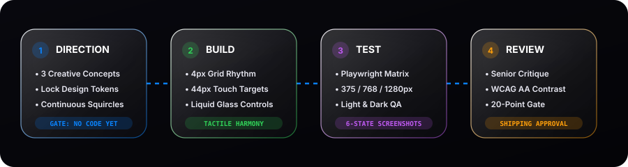
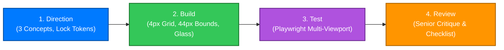

<div align="center">

<p align="center">
  
</p>

# 🍎 Super Apple Design
### The Definitive Multi-Agent Apple Design System & Autonomous Production Engine

**Transform any AI coding agent into a world-class Apple Principal Design Engineer.**  
*Native Human Interface Guidelines (HIG) · Liquid Glass Materials · 4-Phase Gated Production Loop · Multi-Stack Blueprints*

---

[](LICENSE)
[](https://developer.apple.com/design/)
[](skills/apple-design-universal/CHECKLIST.md)
[](#-multi-agent-installation)
[](skills.json)

<br/>

[**Explore Skills**](#-the-4-native-skills) · [**Quick Install**](#-quick-install) · [**4-Phase Workflow**](#-the-4-phase-production-engine) · [**Component Blueprints**](#-multi-stack-component-blueprints) · [**Pre-Flight Gate**](#-20-point-pre-flight-checklist)

</div>

---

## ⚡ The Antidote to "AI-Slop"

Most LLM coding agents produce generic, soulless interfaces: flat gray rectangles, robotic typography, missing active states, unreadable contrast, and completely broken mobile layouts.

**Super Apple Design** eliminates AI-slop by equipping your AI assistants (**Antigravity, Claude Code, Cursor, Codex, Windsurf**) with Apple's 40-year design philosophy codified into **strict, machine-enforceable engineering rules**.

```
┌────────────────────────────────────────────────────────────────────────────────────────┐
│                                   THE 4 CORE PILLARS                                   │
├──────────────────────┬──────────────────────┬────────────────────┬─────────────────────┤
│ 📐 Apple HIG Rules   │ 🧊 Liquid Glass      │ 🔄 4-Phase Engine  │ 🤖 4 Agent Personas │
│ 4px rhythm, 44px hit │ Specular highlights, │ Direction ➔ Build  │ Architect, Auditor, │
│ bounds, optical type │ blur + 190% saturate,│ ➔ Test ➔ Review    │ Physics Specialist, │
│ scales & safe areas  │ spring physics curves│ autonomous QA gate │ Visual QA Tester    │
└──────────────────────┴──────────────────────┴────────────────────┴─────────────────────┘
```

---

## ⚖️ Standard AI Coder vs. Super Apple Design

| Dimension | Standard AI Coding Assistant | Super Apple Design Engine |
| :--- | :--- | :--- |
| **Layout Rhythm** | Random margins (`15px`, `23px`, `37px`) | Strict **4px base scale** (`8, 12, 16, 20, 24, 32, 48, 64px`) |
| **Touch Targets** | Tiny links & compact buttons ($< 30\text{px}$) | Enforced **$\ge 44\times 44\text{px}$ physical hit bounds** |
| **Color Discipline** | Hardcoded raw hex codes (`#333`, `#eee`) | **Adaptive Semantic Tokens** (Canvas, Elevated, Labels) |
| **Materials & Glass** | Heavy milky blur everywhere (glass-on-glass) | **Liquid Glass on control layers only** + Inset specular border |
| **Motion & Easing** | Linear or jarring `ease-in-out` | Harmonic oscillator **Spring Physics** (`150ms - 350ms`) |
| **Accessibility** | Overlooked contrast, missing `:focus` | **WCAG AA $\ge 4.5:1$**, reduced motion & transparency fallbacks |
| **Execution Loop** | Codes blindly on prompt 1 | **Phase 1 Direction Gate** (3 concepts before any code) |

---

## 🔄 The 4-Phase Production Engine

Every user interface, screen, or software component follows an automated, gated quality loop:

<p align="center">
  
</p>



### 1. Phase 1: Direction (Never Code Blindly)
The agent analyzes the user's domain and presents **3 high-contrast, distinct creative directions**:
- **Direction A: Restrained Cupertino Monochrome**: Strict typography hierarchy, deep whitespace, hairline borders, zero visual distraction.
- **Direction B: Luminescent Editorial Vibrancy**: Rich system color accents (Indigo, Sapphire, Emerald), dark mode luminescence, editorial type scale.
- **Direction C: Neo-visionOS Spatial Depth**: Layered 3D glass surfaces, subtle radial specular highlights, floating action docks.
*Tokens (palette, squircle radii, font scale) are locked before writing a single line of layout code.*

### 2. Phase 2: Build (Tactile Craftsmanship)
- Mobile-first architecture starting at `375px` baseline.
- All controls provide complete 5-state coverage: `default`, `hover`, `active (scale 0.97)`, `focus-visible`, and `disabled`.
- Hardware safe areas (`env(safe-area-inset-*)`) handled automatically.

### 3. Phase 3: Test (Autonomous Multi-Viewport QA)
- Headless Playwright runner captures **6 essential states**:
  - `375 x 812` (Mobile phone): Light & Dark Mode
  - `768 x 1024` (Tablet): Light & Dark Mode
  - `1280 x 800` (Desktop): Light & Dark Mode
- Checks: Zero horizontal scroll at `320px`, no clipped text, logical tab order.

### 4. Phase 4: Review (Senior Critique & Shipping Gate)
- Senior designer critique inspecting hierarchy, tracking, optical centering, and contrast.
- Execution of the **20-Point Pre-Flight Shipping Checklist** (`skills/apple-design-universal/CHECKLIST.md`).

---

## 🧩 The 4 Native Skills

```
skills/
├── apple-design-universal/      # Stack-neutral HIG design foundations & rules
├── design-workflow/             # 4-Phase Direction -> Build -> Test -> Review loop
├── liquid-glass-physics/        # Exact spring curves, shaders, and backdrop formulas
└── apple-hig-components/        # Multi-stack component blueprints & state machines
```

### 1. `apple-design-universal`
Master interface specification covering layout, optical typography scaling, semantic color systems, forms, touch ergonomics, and WCAG AA contrast.
- **[SKILL.md](skills/apple-design-universal/SKILL.md)**: Universal specification.
- **[TOKENS.md](skills/apple-design-universal/TOKENS.md)**: CSS Variables, Tailwind v4, Flutter ThemeData, and SwiftUI tokens.
- **[MATERIALS.md](skills/apple-design-universal/MATERIALS.md)**: Liquid Glass, Gaussian blur, and shadow elevation formulas.
- **[CHECKLIST.md](skills/apple-design-universal/CHECKLIST.md)**: The 20-point pre-flight shipping gate.

### 2. `design-workflow`
The autonomous orchestration loop that coordinates creative concepting, code execution, visual verification, and critique.
- **[PHASES.md](skills/design-workflow/PHASES.md)**: Milestone deliverables per phase.
- **[UPSTREAM_ORCHESTRATION.md](skills/design-workflow/UPSTREAM_ORCHESTRATION.md)**: Recipes for the 7 viral community tools (`taste-skill`, `designlang`, `react-bits`, `gsap-skills`, `playwright-cli`, `impeccable`, `transitions.dev`) with graceful fallbacks.

### 3. `liquid-glass-physics`
Specialized physics engine defining exact cubic-bezier spring curves, mass-damping parameters, WebGL fragment shaders, and Skia runtime shaders.
- **[SKILL.md](skills/liquid-glass-physics/SKILL.md)**: Spring curves & haptic timings.
- **[SHADERS.md](skills/liquid-glass-physics/SHADERS.md)**: WebGL/GLSL & Flutter AGSL shader code.

### 4. `apple-hig-components`
Component architecture and state machines for Action Buttons, Segmented Controls, Collapsing Navigation Bars, Modal Sheets, and Floating Docks.
- **[web-react-tailwind.md](skills/apple-hig-components/web-react-tailwind.md)**: React 19 + Tailwind CSS v4 + Framer Motion.
- **[flutter-compose.md](skills/apple-hig-components/flutter-compose.md)**: Flutter (Riverpod/Drift) & Jetpack Compose.
- **[swiftui-native.md](skills/apple-hig-components/swiftui-native.md)**: Native SwiftUI iOS 18+ / macOS 15+.

---

## 🤖 4 Specialized Agent Personas

Super Apple Design includes ready-to-use role definitions in `agents/`:

| Agent | Responsibility | Core Directive |
| :--- | :--- | :--- |
| **🏛️ Apple Design Architect** | System strategist & visual lead | Enforces Phase 1 Direction & Ponytail decision ladder |
| **♿ HIG Accessibility Auditor** | Compliance & universal access | Verifies WCAG AA $\ge 4.5:1$, 44px hit bounds, and keyboard nav |
| **🧊 Liquid Glass Engineer** | Shaders & motion physics | Guards against glass-on-glass stacking; crafts spring curves |
| **🧪 Visual QA Tester** | Autonomous testing & verification | Executes Playwright screenshot matrix across 6 viewport states |

---

## 🎨 Apple HIG Design Formulas (Cheat Sheet)

<p align="center">
  
</p>

### Liquid Glass CSS
```css
/* Standard Liquid Glass with Inset Specular Highlight */
.apple-glass {
  background-color: rgba(255, 255, 255, 0.72);
  backdrop-filter: blur(25px) saturate(190%);
  -webkit-backdrop-filter: blur(25px) saturate(190%);
  border: 1px solid rgba(255, 255, 255, 0.45);
  box-shadow: 
    0 1px 2px rgba(0, 0, 0, 0.04),
    0 12px 32px -4px rgba(0, 0, 0, 0.08),
    inset 0 1px 1px 0 rgba(255, 255, 255, 0.85);
}

@media (prefers-color-scheme: dark) {
  .apple-glass {
    background-color: rgba(28, 28, 30, 0.75);
    border: 1px solid rgba(255, 255, 255, 0.12);
    box-shadow: 
      0 1px 2px rgba(0, 0, 0, 0.40),
      0 16px 40px -4px rgba(0, 0, 0, 0.60),
      inset 0 1px 0.5px 0 rgba(255, 255, 255, 0.15);
  }
}

/* Mandatory Accessibility Fallback */
@media (prefers-reduced-transparency: reduce) {
  .apple-glass {
    background-color: var(--apple-surface-elevated) !important;
    backdrop-filter: none !important;
  }
}
```

### Apple Spring Physics
```css
/* Button Tap & Micro-interaction Spring */
transition: transform 0.20s cubic-bezier(0.175, 0.885, 0.32, 1.275);

/* Modal Sheet & Surface Transition Spring */
transition: transform 0.35s cubic-bezier(0.32, 0.72, 0, 1);
```

### Optical Tracking Hierarchy
- **Large Display Titles (`> 28px`)**: `letter-spacing: -0.022em` (Tighter)
- **Body Content (`16px - 17px`)**: `letter-spacing: -0.008em`
- **Subheadlines (`14px - 15px`)**: `letter-spacing: 0.0em`
- **Small Captions (`< 13px`)**: `letter-spacing: +0.010em` (Airy)

---

## 🚀 Quick Install

### Windows (PowerShell)
```powershell
# Clone the repository
git clone https://github.com/officialtofeekposwal/super-apple-design.git
cd super-apple-design

# Install everywhere (Antigravity, Claude Code, Cursor)
.\scripts\install.ps1 -Target all -Scope global
```

### Linux & macOS (Bash)
```bash
# Clone the repository
git clone https://github.com/officialtofeekposwal/super-apple-design.git
cd super-apple-design
chmod +x scripts/install.sh

# Install everywhere
./scripts/install.sh --target all --global
```

### Tool-Specific Installation

| Assistant | Command | Target Location |
| :--- | :--- | :--- |
| **Claude Code** | `./scripts/install.sh --target claude --global` | `~/.claude/skills/` |
| **Antigravity** | `./scripts/install.ps1 -Target antigravity -Scope global` | `~/.gemini/antigravity/skills/` |
| **Cursor** | `./scripts/install.sh --target cursor` | `.cursor/rules/*.mdc` |
| **Codex / Windsurf** | *Automatic* | Root `AGENTS.md` instruction manual |

---

## 💬 How to Prompt Your Agent

### Kick off a new screen (Phase 1):
```markdown
Use design-workflow and apple-design-universal.
I am building a personal finance dashboard.
Execute Phase 1 (Direction) first: analyze my domain and propose 3 high-contrast design directions before writing any code.
```

### Build tactile components (Phase 2):
```markdown
Let's proceed with Direction B (Luminescent Editorial Vibrancy).
Build the responsive Navigation Bar and Account Balance Card following Apple HIG:
- Strict 4px rhythm
- Minimum 44x44px hit bounds
- Liquid Glass applied strictly to the sticky control header
```

### Autonomous visual test (Phase 3):
```markdown
Run the Playwright multi-viewport test script on http://localhost:3000.
Capture screenshots at 375px (mobile), 768px (tablet), and 1280px (desktop) in Light and Dark mode.
Report any layout overflow or contrast bugs.
```

### Senior design review (Phase 4):
```markdown
Conduct an Impeccable review of this screen.
Check all items against the 20-Point Pre-Flight Shipping Checklist in skills/apple-design-universal/CHECKLIST.md.
Fix all Critical and Important issues.
```

---

## 📁 Repository Map

```
super-apple-design/
├── .claude-plugin/
│   └── plugin.json                  # Claude Code plugin manifest
├── .cursor/
│   └── rules/
│       ├── apple-design.mdc         # Cursor HIG foundations rule
│       └── design-workflow.mdc      # Cursor 4-phase production rule
├── agents/                          # Specialized Agent Subsystems
│   ├── apple-design-architect.md    # High-level system design & layout strategist
│   ├── hig-accessibility-auditor.md # WCAG AA 4.5:1, keyboard nav, screen reader auditor
│   ├── liquid-glass-engineer.md     # Shader, CSS backdrop, and tactile physics specialist
│   └── visual-qa-tester.md          # Autonomous Playwright screenshot & viewport inspector
├── prompts/
│   ├── antigravity-install.md       # Multi-language quickstart (Hinglish + English)
│   ├── claude-code-install.md       # Claude Code CLI setup guide
│   └── design-brief-generator.md    # Phase 1 Direction interactive questionnaire
├── scripts/
│   ├── install.sh                   # Universal bash installer for Linux/macOS
│   ├── install.ps1                  # Native PowerShell installer for Windows
│   ├── audit-design.py              # Automated design & accessibility linter
│   └── playwright-viewport-test.js  # Headless multi-viewport screenshot runner (375, 768, 1280px)
├── skills/
│   ├── apple-design-universal/      # Master HIG Universal Specification
│   │   ├── SKILL.md                 # Core rules (4px rhythm, typography, contrast, safe areas)
│   │   ├── TOKENS.md                # Multi-stack tokens (CSS, Tailwind, Flutter, SwiftUI)
│   │   ├── MATERIALS.md             # Liquid Glass, blur, noise, and shadow elevation formulas
│   │   └── CHECKLIST.md             # 20-point pre-flight shipping gate
│   ├── design-workflow/             # The 4-Phase Production Engine
│   │   ├── SKILL.md                 # Direction -> Build -> Test -> Review loop
│   │   ├── PHASES.md                # Detailed deliverables per phase
│   │   └── UPSTREAM_ORCHESTRATION.md# Integration recipes for the 7 viral design skills
│   ├── liquid-glass-physics/        # Dedicated Tactile & Spatial Physics Skill
│   │   ├── SKILL.md                 # Spring curves, haptic timing, glass overlays, fallbacks
│   │   └── SHADERS.md               # WebGL/GLSL, CSS filter, and Skia/Flutter shaders
│   └── apple-hig-components/        # Stack-Specific Component Blueprints
│       ├── SKILL.md                 # Navigation bars, segmented controls, modal sheets, cards
│       ├── web-react-tailwind.md    # React 19 + Tailwind v4 snippets
│       ├── flutter-compose.md       # Flutter Drift/Riverpod & Jetpack Compose recipes
│       └── swiftui-native.md        # Native SwiftUI iOS/macOS patterns
├── tokens/                          # Raw Machine-Readable Design Tokens
│   ├── colors.json                  # Light & Dark semantic color palette
│   ├── typography.json              # Type scales, weights, and letter-spacing
│   └── spacing-radii.json           # 4px scale, squircle radius definitions
├── AGENTS.md                        # Master agent behavioral rules & Ponytail decision ladder
├── CREDITS.md                       # Full attribution & upstream repo links
├── LICENSE                          # MIT License
├── .gitignore                       # Clean ignore rules
└── README.md                        # This documentation
```

---

## 🛡️ Guiding Principles & Ethics

1. **Brand Primacy**: The user's brand identity, custom colors, and guidelines **always supersede** these defaults.
2. **No IP Infringement**: Never copy Apple trademarks, proprietary fonts (`SF Pro` binaries), or protected icons into client code. Use open system font stacks and open-source icons (Lucide, Heroicons).
3. **No Design Plagiarism**: Reference sites are used strictly for structural inspiration and token sampling—never clone competitor branding.
4. **Honest Copywriting**: Never invent fake statistics or fabricated testimonials.

---

## 📄 License & Attribution

MIT © 2026 [Tofeek Poswal](https://github.com/officialtofeekposwal) & Open Source Contributors. See [LICENSE](LICENSE) for details.

*Disclaimer: This open-source repository is independent and not affiliated with, sponsored by, or endorsed by Apple Inc. "Apple", "iOS", "macOS", "visionOS", and "Liquid Glass" are trademarks of Apple Inc.*
